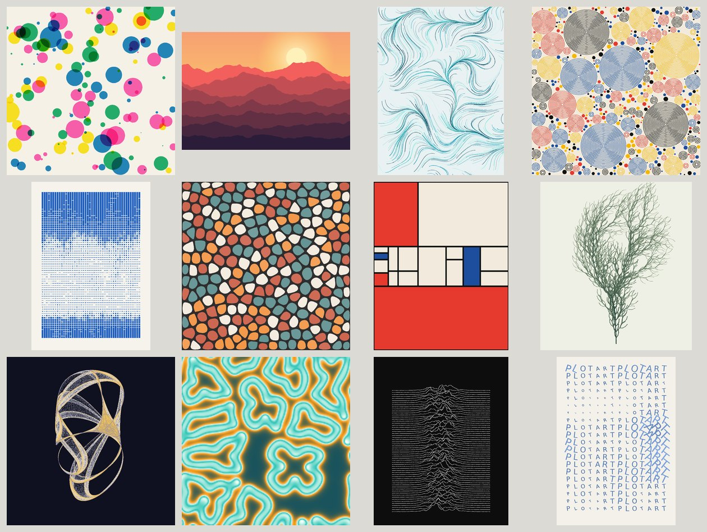
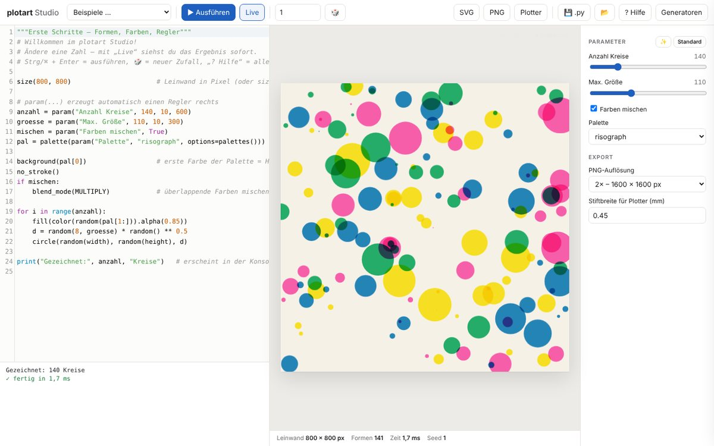
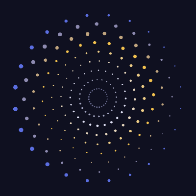
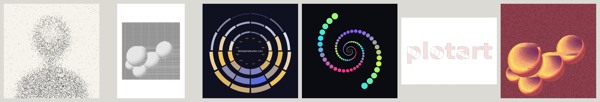
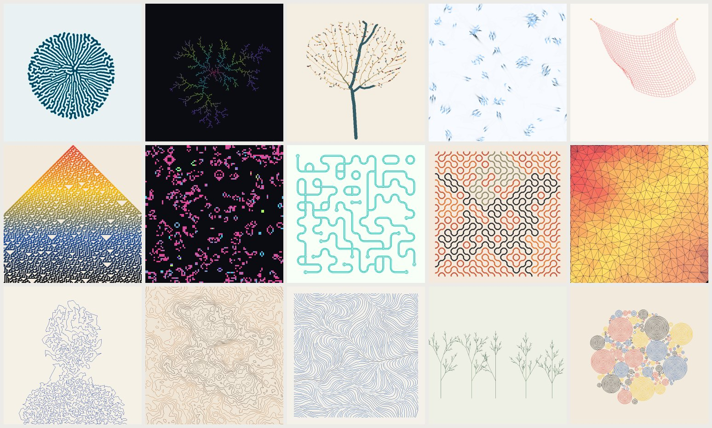
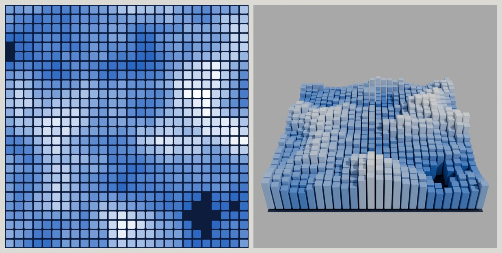
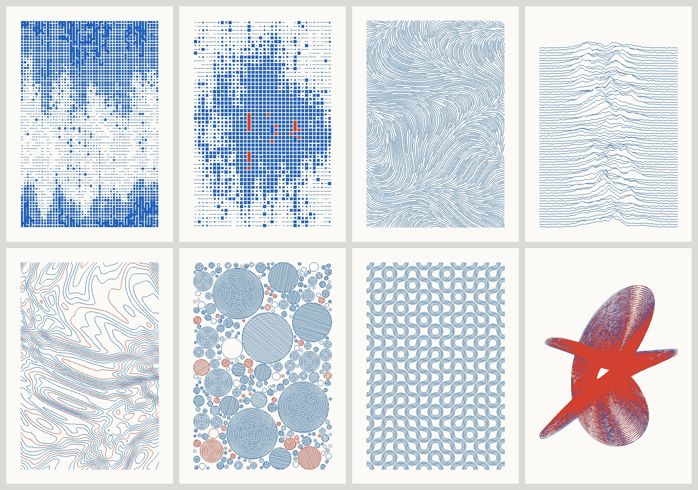

# plotart – generative Kunst mit Python

Ein Werkzeug, um **generative und algorithmische Kunst in Python** zu erschaffen. Du schreibst Skizzen in einer Sprache **im Stil von p5.js/Processing** und siehst das Ergebnis sofort. Standbilder oder **Animationen**, Ausgabe als **PNG, SVG, MP4, GIF oder plotterfertige Linien**. Gemacht für den Computer, läuft aber auch im Browser und am iPad.



## Highlights

- **Skizzen-Sprache wie p5.js:** `size()`, `background()`, `fill()`, `circle()`, `begin_shape()`, `push()`/`pop()`, `translate()`, `rotate()`, `noise()`, `random()` …
- **Live-Studio im Browser:** Code-Editor mit Syntax-Hervorhebung und Autovervollständigung, Vorschau bei jeder Änderung, Fehler mit Zeilennummer, durchsuchbare API-Hilfe
- **Regler automatisch:** `n = param("Anzahl", 40, 1, 200)` erzeugt einen Schieberegler
- **Volle Python-Power:** numpy, scipy, Pillow und jede andere installierte Bibliothek; Rasterbilder per `image(array)`
- **Farbe ernst genommen:** Transparenz, HSB, Verläufe (linear/radial), Mischmodi (Multiply, Screen, …), 16 kuratierte Paletten
- **Werkzeugkasten für generative Kunst:** Voronoi, Poisson-Disc, Lloyd-Relaxation, Chaikin-Glättung, Schraffur, Vektoren
- **Animation wie in p5.js:** `setup()` und `draw()`, Zustand über Bilder hinweg, Spuren durch halbtransparenten Hintergrund, `t` für nahtlose Loops, Easing-Funktionen
- **Zeitleiste im Studio:** Abspielen, Spulen, Bild für Bild, Geschwindigkeit
- **Exporte:** Farb-SVG, PNG in jeder Auflösung (z. B. 300 dpi), **MP4, WebM, GIF, PNG-Sequenz**, **Plotter-SVG** (optimierte Linien, eine Ebene pro Farbe)
- **Desktop-Arbeitsweise:** Skizzen im Ordner `skizzen/`, Speichern mit Strg+S; bearbeitest du die Datei in VS Code o. Ä., aktualisiert sich das Studio automatisch
- **Blender-Anbindung:** Skizzen als Blender-Objekte (Flächen, Linien als Bänder oder 3D-Röhren, Text, Bilder), **Relief-Modus** für 3D-Skulpturen, Animationen auf der Zeitleiste, Add-on mit Reglern und automatischem Neuladen
- **Bilder & Daten:** Fotos laden und Pixel abfragen (Stippling, Schraffur …), CSV/JSON (auch mit Dezimalkomma), SVG-Import, **Text als Pfade** aus TrueType-Schriften
- **Pixel & Filter:** `pixels` als numpy-Array, 16 Filter (Weichzeichnen, Körnung, Dithering …), `filter()` auf die ganze Leinwand, `snapshot()` für Feedback-Effekte
- **Kuration:** Varianten-Raster, Favoriten mit Vorschaubild, Versionsverlauf, Serien-Export mit Kontaktbogen, Regler-Keyframes für Animationen
- **Editionen & Großformat:** Merkmale mit `feature()` und Seltenheiten wie bei Art Blocks/fxhash, Metadaten und Galerie-Seite; große Drucke auf mehreren A4-/A3-Blättern mit Schnittmarken
- **Ton & Interaktion:** `load_audio()` mit Pegel, Spektrum, Bass/Mitten/Höhen und Beat-Erkennung, Ton im Video; Maus, Tastatur und MIDI live im Studio, Aufnahme der Eingaben für den Export
- **3D in der Skizze:** `box()`, `sphere()`, `torus()`, `mesh()`, Kamera, Lichter, `orbit_control()`; Export als **glTF (.glb)/OBJ**, echte 3D-Objekte in Blender, **verdeckte Linien entfernen** für 3D-Plots
- **TouchDesigner & OSC:** Studio per OSC fernsteuern, `osc()`/`osc_send()` in Skizzen, Skizzen als Live-Textur in einem Script TOP
- **p5.js, Processing und R im Studio:** R-Skripte (ggplot2, aRtsy) am Computer über Rscript, im Browser über webR; p5.js-Sketches laufen direkt im Browser (Regler, Seed, PNG, Video); `.pde`-Sketches mit dem installierten Processing ausführen oder nach plotart-Python übertragen
- **Live & VJ:** Live-Coding ohne Neustart (der Zustand bleibt), Takt mit `bpm`/`beat`/`on_beat()` aus Tap-Tempo oder Ableton Link, Ausgabefenster für den Beamer, Video live per NDI oder Spout an OBS, Resolume und TouchDesigner
- **Algorithmic-Art-Workflow:** Konzept als Docstring, Seed-Navigation ◀ ▶, jede Skizze als **eigenständige Web-Seite** teilen
- **p5.js/py5-kompatibel:** camelCase-Namen (`noFill()`, `strokeWeight()`, `createCanvas(…, WEBGL)`, `frameCount` …), shapely-Geometrie und Schraffur eingebaut
- **GPU-Shader:** GLSL-Fragment-Shader im Shadertoy-Stil als Bildebene oder Nachbearbeitung (`shader_image()`, `apply_shader()`), am Computer über moderngl, im Browser über WebGL2
- **Algorithmen-Baukasten:**
  - Wachstum: Differential Growth, DLA, Space Colonization
  - Simulation: Verlet-Physik, Schwärme, zelluläre Automaten, Reaktion-Diffusion
  - Muster: Wave Function Collapse, Truchet, Delaunay, TSP-Kunst, Höhenlinien, Stromlinien, L-Systeme, Kreispackung
- **Mathe-Kunst:**
  - Kurven: Lissajous, Rosen, Harmonograph, Spirograph, Superformel, Fourier-Epizykel
  - Funktions-Plotter mit Formeln als Text, numerische Integration als Bild (Riemann, Trapez, Simpson)
  - Differentialgleichungen: RK4, Phasenporträts, seltsame Attraktoren
  - Fraktale: Mandelbrot, Julia, Newton, IFS, Fractal Flames; Domain Coloring komplexer Funktionen
- **63 Beispiel-Skizzen** zum Lernen und Weiterbauen
- **Reproduzierbar:** gleicher Seed + gleiche Regler = identisches Bild
- **Zusätzlich: 7 fertige Plotter-Generatoren** mit Reglern, ganz ohne Code

## Schnellstart

```bash
git clone https://github.com/lasagnebot100/SVG.git && cd SVG
python3 -m plotart
```

Das **Studio** öffnet sich unter `http://localhost:8765`.

1. Oben **„Beispiele …“** wählen oder direkt im Editor losschreiben. Mit **Live** aktualisiert sich das Bild bei jeder Änderung.
2. **🎲** würfelt einen neuen Seed, **✨** würfelt alle Regler.
3. Exportieren über **SVG**, **PNG** oder **Plotter**; **💾 .py** speichert die Skizze.

Optional: `pip install -e ".[full]"` installiert Pillow, numpy, imageio-ffmpeg (für Videos), shapely und moderngl (für Shader) sowie den Befehl `plotart`.

### Unter Windows (PowerShell)

Python 3.11 bis 3.14 von [python.org](https://www.python.org/downloads/windows/) installieren. Danach jeden Befehl einzeln ausführen:

```powershell
git clone https://github.com/lasagnebot100/SVG.git
cd SVG
py -m pip install -e ".[full]"
plotart
```

- **`plotart` wird nicht gefunden?** Dann liegt der Scripts-Ordner von Python nicht im `PATH`. `py -m plotart` funktioniert immer.
- **`python3` öffnet den Microsoft Store?** Unter Windows heißt der Befehl `py` oder `python`.
- **Schriften:** `text_paths()` findet die Schriften aus `C:\Windows\Fonts` und die nur für den eigenen Benutzer installierten. `font="sans-bold"` wählt automatisch eine fette Schrift (unter Windows Arial Bold).



## Deine erste Skizze

```python
size(800, 800)                                  # Pixel – oder size("A3") in Millimeter
anzahl = param("Anzahl", 120, 10, 500)          # → Regler im Studio
pal = palette("risograph")                      # kuratierte Farbpalette

background(pal[0])
no_stroke()
blend_mode(MULTIPLY)                            # Farben mischen sich wie Druckfarbe
for i in range(anzahl):
    fill(color(random(pal[1:])).alpha(0.85))
    circle(random(width), random(height), random(10, 120))
```

Optional kannst du `setup()` und `draw()` definieren wie in p5.js; beide werden einmal aufgerufen.

## Animation



Sobald eine Skizze `draw()` definiert, wird sie zur Animation. `draw()` läuft dann für jedes Bild.

```python
size(800, 800)
animation(frames=180, fps=30)          # 6 Sekunden

def draw():
    background("#0f1020")              # jedes Bild frisch – ohne background() malt es weiter
    no_stroke()
    for i in range(12):
        a = TAU * (t + i / 12)         # t läuft von 0 bis 1 → nahtloser Loop
        fill(hsb(i * 30, 70, 100))
        circle(width / 2 + cos(a) * 250, height / 2 + sin(a) * 250, 60)
```

| Was | Wie |
|---|---|
| Länge & Tempo | `animation(frames=240, fps=30)` · `duration(8)` (Sekunden) · `frame_rate(24)` |
| Zeit | `t` (0 … 1 über die ganze Animation) · `frame_count` (1, 2, 3 …) · `time` (Sekunden) · `frames`, `fps` |
| Zustand | Variablen in `setup()` anlegen, in `draw()` verändern (mit `global` für einfache Werte) |
| Spuren | `background(0, 20)` – halbtransparent, ältere Bilder verblassen langsam |
| Wachsende Bilder | kein `background()` in `draw()` – jedes Bild malt auf das vorige weiter |
| Nahtlose Loops | alles nur von `t` abhängig machen · `loop_noise(x, y, t)` · `wave(t, cycles)` · `ping_pong(t)` |
| Easing | `ease_in()` · `ease_out()` · `ease_in_out()` · `ease_in_out_cubic()` · `ease_out_elastic()` |
| Standbild trotz `draw()` | `no_loop()` |

Wie in p5.js werden Transformationen vor jedem Bild zurückgesetzt, Farben und Stile bleiben erhalten.

**Im Studio:**
- Unter der Vorschau erscheint eine **Zeitleiste**: ▶/⏸ mit der Leertaste, Spulen mit dem Regler, ← → für einzelne Bilder.
- **Rechts unter „Animation exportieren“** wählst du Format (MP4, WebM, GIF, PNG-Sequenz), Auflösung, Bildanzahl und fps.
- Der Export läuft im Hintergrund mit Fortschrittsbalken und landet im Ordner `output/`.

MP4 und WebM brauchen **ffmpeg**: entweder installieren (https://ffmpeg.org/download.html) oder `pip install imageio-ffmpeg`. GIF und PNG-Sequenz funktionieren auch ohne ffmpeg.

## Bilder & Daten



Dateien legst du in den Ordner `skizzen/daten/` (im Studio: Bereich **„Daten“**, „＋ Datei“ oder einfach auf die Vorschau ziehen). Ein Klick auf eine Datei fügt den passenden Befehl in den Code ein. Für erste Versuche gibt es eingebaute Beispiele: `"beispiel:portrait"`, `"beispiel:kugeln"`, `"beispiel:verlauf"`, `"beispiel:schrift"`, `"beispiel:temperaturen.csv"`, `"beispiel:zufall.json"`, `"beispiel:gedicht.txt"`.

```python
img = load_image("foto.jpg")                  # aus skizzen/daten/
img.brightness(x, y)                          # 0 (schwarz) … 1 (weiß)
img.get(x, y)                                 # Farbe des Pixels
img.grid(40)                                  # mittlere Helligkeit pro Rasterzelle
image(img.filter(BLUR, 3), 0, 0, width, height)

rows = load_csv("messwerte.csv")              # Liste von Dicts, 12,5 → 12.5
svg = load_svg("logo.svg"); draw_svg(svg, 100, 100, w=300)
umrisse = text_paths("Hallo", 50, 200, 120, font="sans-bold")   # Buchstaben als Punktlisten
text_shape("Hallo", 50, 200, 120)             # Text als echte Form (Plotter, Blender)
```

| Funktion | Zweck |
|---|---|
| `load_image(pfad)` | Bild laden → `.width`, `.height`, `.get()`, `.brightness()`, `.sample(u, v)`, `.grid()`, `.pixels`, `.resize()`, `.crop()`, `.rotate()`, `.filter()`, `.dither()` |
| `load_csv` · `load_json` · `load_text` · `load_lines` | Daten laden (CSV erkennt `;`, `,`, Tab und Dezimalkomma) |
| `load_svg` · `draw_svg` | SVG-Grafiken als Punktlisten importieren und zeichnen |
| `text_paths` · `text_shape` | Text als Umrisse (TrueType-Schriften des Systems oder eigene `.ttf` aus `daten/`; `"sans"` bzw. `"sans-bold"` wählt eine passende Schrift des jeweiligen Systems) |

## Pixel & Filter

| Funktion | Zweck |
|---|---|
| `create_image(w, h)` | Leeres Bild für Pixel-Algorithmen |
| `img.pixels` / `img.set_pixels(arr)` | Pixel als numpy-Array H × W × 4 (0 … 1) lesen und schreiben |
| `img.filter(art, stärke)` | `BLUR`, `SHARPEN`, `EDGES`, `EMBOSS`, `GRAY`, `INVERT`, `POSTERIZE`, `THRESHOLD`, `CONTRAST`, `BRIGHTNESS`, `SATURATION`, `PIXELATE`, `GRAIN`, `DITHER`, `SEPIA`, `LEVELS` |
| `filter(art, stärke)` | Filter auf die ganze Leinwand (wie in p5) |
| `snapshot()` | Bisher Gezeichnetes als Bild – im nächsten Animationsbild wieder zeichnen = Feedback-Effekte (Beispiel 22) |

`filter(funktion, liste)` funktioniert weiterhin wie Pythons eingebautes `filter`.

## Kuration & Serien

- **🔲 Varianten** (Taste V): Das Studio rendert 9, 16 oder 25 Seeds als Vorschau. Mit „Regler auch würfeln“ werden auch die Regler zufällig gewählt. Ein Klick übernimmt die Variante.
- **★ Favoriten** (Taste F): Seed, Regler und Keyframes werden mit Vorschaubild und Notiz gespeichert. Bei gespeicherten Skizzen landen sie in `skizzen/.plotart/<name>.json`, wandern also mit der Datei mit.
- **🕘 Verlauf:** Jedes Speichern archiviert die vorige Fassung (die letzten 50) in `skizzen/.plotart/verlauf/`. Ältere Fassungen lassen sich mit einem Klick laden.
- **🗂 Serie exportieren:** Viele Seeds auf einmal als PNG, SVG und/oder Plotter-SVG, mit **Kontaktbogen** und `serie.json`. Per Kommandozeile: `python3 -m plotart sketch 06 -n 24 --sheet --png`.
- **◆ Regler-Keyframes** (Animationen): Bild wählen, Regler einstellen, ◆ klicken – zwischen den Keyframes wird weich übergeblendet. Das wirkt für alle `param()`, die in `draw()` abgefragt werden; es gilt auch für Video- und Blender-Export.

## Editionen & Großformat

Eine Skizze als **Edition** wie bei Art Blocks oder fxhash: Jeder Seed ist ein eigenes Werk mit eigenen Merkmalen.

```python
palette_name = feature("Palette", random_choice(["nacht", "bauhaus", "risograph"], [6, 3, 1]))
goldrand = feature("Goldrand", random_choice([True, False], [1, 19]))   # selten: 5 %
```

- **`feature(name, wert)`** hält ein Merkmal fest und gibt den Wert unverändert zurück.
- **Merkmale im Studio:** Unter den Reglern stehen die Merkmale des aktuellen Seeds.
  - **Seltenheit prüfen** wertet 50, 100 oder 250 Seeds aus und zeigt die Anteile als Balken.
  - Ein Klick auf einen Wert springt zum ersten Seed mit diesem Wert.
- **Serien-Export als Edition:** Hat die Skizze Merkmale, schreibt der Serien-Export zusätzlich:
  - `metadata/<seed>.json` je Werk im üblichen Galerie-/NFT-Format (Name, Beschreibung, Bild, `attributes`, Seltenheitsrang),
  - `edition.json` mit allen Merkmalen und Anteilen,
  - `galerie.html`: eine eigenständige Galerie-Seite mit Filtern je Merkmal, Sortierung nach Seltenheit und Detailansicht – direkt auf eine Website hochladbar.
  - Titel und Beschreibung kommen aus dem Konzept (Docstring); Künstler/in ist ein eigenes Feld bzw. `--artist`.
- **🧩 Großformat drucken:** verteilt ein Werk auf mehrere A4-, A3- oder Letter-Blätter.
  - Hoch- oder Querformat wird automatisch gewählt, alle Blätter sind gleich groß.
  - Je Blatt Schnittmarken, blaue Klebe-Markierungen (Überlappung) und eine Beschriftung.
  - Ausgabe: PNG je Blatt, `alle_blaetter.pdf`, SVG je Kachel in Millimetern (auch für den Plotter) und `uebersicht.png` zum Zusammensetzen.
  - Skizzen in mm werden 1 : 1 gedruckt; bei Pixeln oder zum Vergrößern die Druckbreite in mm angeben.

```bash
python3 -m plotart sketch 62 -n 50 --sheet --png --artist "Name"     # Edition mit Galerie
python3 -m plotart sketch 63 --tiles A4                               # Plakat A2 auf A4-Blättern
python3 -m plotart sketch 44 --tiles A3 --print-width 1000 --dpi 300  # 1 m breit auf A3
```

- **Beispiele:** 62 (Edition: Fenster ins Raster), 63 (Höhenlinien-Plakat in A2).

## Ton & Interaktion

**Audio-reaktiv** – Beispiel 29:

```python
ton = load_audio("musik.mp3")          # aus skizzen/daten/; eingebaut: "beispiel:beat.wav"
def draw():
    background(0, 40)
    circle(width / 2, height / 2, 100 + 400 * ton.bass())
    if ton.beat():
        fill("#ff2e88")
    for i, v in enumerate(ton.spectrum(32)):
        rect(i * 25, height, 20, -v * 300)
```

- Werte von 0 bis 1:
  - `level()`, `spectrum(n)`, `bass()`, `mid()`, `treble()`, `energy(lo, hi)`
  - `waveform(n)` für Oszilloskop-Linien
  - `beat()`, `since_beat()`, `beats()`
- **Länge und Ton:** Die Animation dauert so lang wie der Ton. Im Studio läuft er synchron mit (🔊). MP4/WebM-Exporte enthalten die Tonspur.
- **Formate:** WAV geht direkt, MP3/OGG/FLAC über ffmpeg.

**Maus, Tastatur, MIDI** – 🎮 **Interaktiv** (Taste I) in der Zeitleiste:
- **Variablen** wie in p5: `mouse_x`, `mouse_y`, `pmouse_x`, `mouse_is_pressed`, `key`, `key_is_pressed`.
- **Ereignisse:** `mouse_pressed()`, `mouse_dragged()`, `mouse_wheel(delta)`, `key_pressed()` und weitere.
- **⏺ Aufnahme:** Nimmt die Eingaben Bild für Bild auf. Vorschau und Video-Export spielen sie exakt ab.
- **🎹 MIDI-Learn:** Regler anklicken, am Controller drehen (Chrome, Edge, Firefox). Mit `midi(cc)` liest die Skizze Controller direkt.
- **Live-Regler:** Im Interaktiv-Modus wirken Regler sofort, wenn `param()` in `draw()` steht.

## 3D

```python
lights()
translate(width / 2, height / 2)
rotate_x(0.5); rotate_y(t * TAU)
fill("#1f5fbf"); box(200)
```

- **Formen:**
  - `box`, `sphere`, `ellipsoid`, `cylinder`, `cone`, `torus`, `plane`
  - `mesh(punkte, flächen)`, `line3d`, `polyline3d`
- **Kamera und Licht:**
  - `camera()`, `perspective()`, `ortho()`, `orbit_control()`
  - `lights()`, `ambient_light()`, `directional_light()`, `point_light()`
- **Ebene z = 0** entspricht genau der 2D-Leinwand. 2D und 3D lassen sich mischen.
- **Exporte:**
  - Knopf **3D** im Studio: `.glb`; mit Umschalt: `.obj`.
  - **Plotter** mit „Verdeckte Linien entfernen“: saubere Strichzeichnungen von 3D-Szenen.
  - **Blender:** baut echte Meshes.

## Algorithmen-Baukasten



Bewährte Verfahren der generativen Kunst als fertige Bausteine. Sie geben Punkte und Linien zurück, die du frei gestaltest: Farbe, Strichstärke, Animation, Plotter.

| Bereich | Funktion | Was entsteht |
|---|---|---|
| **Wachstum** | `DifferentialGrowth(punkte)` · `.step()` · `.points` | Linie, die sich wie Koralle oder Gehirn faltet |
| | `DLA(seeds)` · `.grow(n)` · `.segments` | Korallen, Eisblumen, Blitze |
| | `SpaceColonization(lichter, wurzeln)` · `.grow()` · `.branches` | Bäume, Adern, Wurzeln (mit Astdicke) |
| **Simulation** | `Physics()` · `.add()` · `.spring()` · `.rope()` · `.cloth()` · `.attract()` | Seile, Stoff, Netze, die reißen können |
| | `Flock(n, w, h)` · `.step()` · `.boids` | Schwärme (Boids) |
| | `elementary_ca(regel)` · `Life(spalten, zeilen, regel="B3/S23")` | Zellautomaten, Game of Life und Verwandte |
| | `reaction_diffusion(…, feed, kill)` | Turing-Muster (braucht numpy) |
| **Muster** | `wave_function_collapse(spalten, zeilen, "rohre")` · `tile_paths()` | lückenlose Kachelmuster (Sätze „rohre“, „platine“ oder eigene) |
| | `truchet()` · `join_paths()` | Truchet-Kacheln, zu langen Linien verbunden |
| | `delaunay(punkte)` · `delaunay_edges()` | Dreiecksnetze, Low-Poly |
| | `tsp_path(punkte)` | ein Bild aus einer einzigen Linie |
| | `contours(fn, stufen, w, h)` · `contour_lines(feld, höhen)` | Höhenlinien wie auf der Wanderkarte |
| | `streamlines(richtung, w, h, abstand)` | gleichmäßig verteilte Stromlinien |
| | `lsystem(axiom, regeln, n)` · `turtle(text)` | Pflanzen, Fraktale (auch zufällige Regeln) |
| | `circle_packing(w, h, min_r, max_r, inside=…)` | dichte Kreispackungen, auch in Formen |

- **Deterministisch:** Alle Funktionen nutzen den Seed der Skizze.
- **Animierbar:** Die Klassen (`DifferentialGrowth`, `DLA`, `Flock`, `Physics`, `Life` …) rechnen Schritt für Schritt in `draw()`.
- **Schnell:** numpy beschleunigt einige Verfahren, wenn es installiert ist. Ohne numpy laufen sie in reinem Python.
- **Beispiele:** Skizzen 36–50.

## Mathe-Kunst

Mathematik als Bild: Kurven, Flächen, Bahnen und Fraktale. Kurven und Bahnen sind Punktlisten (gut für den Plotter), Fraktale und Domain Coloring sind Pixelfelder für `image()`.

| Bereich | Funktion | Was entsteht |
|---|---|---|
| **Kurven** | `lissajous(a, b)` · `rose(n, d)` · `spirograph(R, r, d)` · `superformula(m, n1, n2, n3)` | klassische Kurven als Punktliste |
| | `harmonograph()` | gedämpfte Pendel, verschlungene Spiralen (Seed-abhängig) |
| | `Epicycles(punkte, terms)` · `.circles(t)` · `.path(t)` · `fourier_approx()` | eine Zeichnung aus rotierenden Kreisen (Fourier) |
| **Funktionen** | `Graph(x0, x1, y0, y1, links, oben, w, h)` · `.curve(f)` · `.axes()` · `.labels()` · `.area()` | Koordinatensystem, Funktionsgraphen mit Polstellen |
| | `formula("sin(x)^2")` · `formula("z^3 - 1", "z")` | Formel als Text, z. B. aus einem Regler |
| | `riemann(f, a, b, n, "simpson")` · `integrate(f, a, b)` | Streifen, Trapeze, Parabeln und Fehlerflächen |
| **Dynamik** | `rk4(f, y0, t0, t1, dt)` · `phase_portrait(f, …)` | Lösungen und Bahnen von Differentialgleichungen |
| | `attractor("lorenz")` · `fit_points()` · `density()` | Lorenz, Rössler, Aizawa, Clifford, De Jong … |
| **Fraktale** | `mandelbrot()` · `julia()` · `colorize(feld, farben, cycles)` | Fluchtzeit-Fraktale mit Farbbändern |
| | `newton_fractal(w, h, roots)` | Einzugsgebiete der Nullstellen |
| | `ifs("farn")` · `fractal_flame()` | Chaos-Spiel und Fractal Flames |
| **Komplex** | `domain_coloring(f, w, h, …, style)` | Farbton = Winkel, Helligkeit = Betrag |

- **Mit und ohne numpy:** Die Pixel-Funktionen nutzen numpy, wenn es installiert ist; sonst rechnen sie in reinem Python.
- **Auch auf der GPU:** Beispiel 59 rechnet die Julia-Menge als Shader in Echtzeit.
- **Beispiele:** Skizzen 51–59.

## Shader (GPU)

Ein Fragment-Shader rechnet **jedes Pixel gleichzeitig auf der Grafikkarte**. Damit sind Effekte in Echtzeit möglich, die Form für Form zu langsam wären: fließende Farbfelder, Fraktale, Verzerrungen, Rückkopplung.

```python
sh = create_shader("""
uniform float zoom;
void mainImage(out vec4 fragColor, in vec2 fragCoord) {
    vec2 uv = fragCoord / iResolution.xy;
    fragColor = vec4(uv, 0.5 + 0.5 * sin(iTime * zoom), 1.0);
}""")

def draw():
    shader_image(sh, zoom=param("Zoom", 2.0, 0.1, 10.0))   # Regler → Uniform
    fill(255); circle(width / 2, height / 2, 100)          # normal darüber zeichnen
```

- **Schreibweise wie auf [Shadertoy](https://www.shadertoy.com/):**
  - `mainImage()` mit den Uniforms `iResolution`, `iTime`, `iFrame`, `iMouse` und `iChannel0`–`iChannel3`.
  - Viele Shadertoy-Shader laufen ohne Änderung.
  - Wer will, schreibt ein eigenes `void main()`.
- **Funktionen:**
  - `shader_image(sh, x, y, w, h, **uniforms)` zeichnet den Shader als Bild.
  - `apply_shader(sh)` bearbeitet die ganze Leinwand nach; das bisher Gezeichnete ist `iChannel0`.
  - Bilder gehen als `iChannel0=img` hinein.
- **Uniforms:** Zahlen, Vektoren und Farben (`"#ff0080"` wird zu `vec3`) als Schlüsselwörter. Mit `param()` in `draw()` sind sie Regler und mit ◆ keyframe-fähig.
- **Wo es läuft:**
  - **am Computer** über moderngl (`pip install moderngl`, Linux ohne Bildschirm: Pakete `libegl1` und `libgl1-mesa-dri`),
  - **im Browser-Studio und in geteilten Web-Seiten** über WebGL2, ohne Installation.
- **Fehler** im Shader erscheinen mit Zeilennummer im Shader-Text.
- **Ergebnis:** ein normales Bild, also SVG, PNG, Video und Blender wie gewohnt. Der Plotter überspringt es, denn es enthält keine Linien.
- **Neue Skizze mit Shader:** „📁 Meine Skizzen“ › „＋ Neuer Shader (GPU)“.

## TouchDesigner & OSC

```bash
python3 -m plotart studio --osc-in 9000 --osc-out 127.0.0.1:9001
```

- **Fernsteuerung** per OSC: `/param/<Name>`, `/seed`, `/random`, `/play`, `/pause`, `/live`.
- **In Skizzen:** `osc("/td/level", 0)` liest Werte, `osc_send("/plotart/x", wert)` schickt sie zurück.
- **Als Textur in TouchDesigner:** `python3 -m plotart touchdesigner` schreibt die Callbacks-Datei für einen Script TOP.
- Anleitung, Begriffe und Lernpfad: **[docs/touchdesigner.md](docs/touchdesigner.md)**.

## Live & VJ

Für Auftritte und Installationen: Im Studio **🎮 Interaktiv** einschalten (Taste I). Darunter erscheint die Live-Leiste.

- **♻ Live-Code:** Code-Änderungen werden übernommen, während die Skizze läuft.
  - Funktionen und Klassen werden ausgetauscht; Variablen nur, wenn ihre Zeile geändert wurde oder von einer geänderten Zeile abhängt.
  - `setup()` läuft nicht erneut, `frame_count` zählt weiter. **↺ Neustart** beginnt von vorn.
  - Ein Tippfehler hält nichts an: Die Zeile wird markiert, die letzte funktionierende Fassung läuft weiter.
  - Regler wirken auch auf `param()`-Variablen außerhalb von `draw()`.
- **Takt:** In der Skizze stehen `bpm`, `beat` (Schläge als Kommazahl), `beat_phase` (0 … 1) und `bar` (Takt) bereit.
  - `tempo(128)` legt das Tempo fest; im Export und in der Vorschau läuft der Takt danach.
  - `on_beat(n)` wird bei jedem Schlag aufgerufen, `beat_pulse(5)` blitzt auf dem Schlag auf.
  - Live kommt der Takt wahlweise aus der Skizze, aus **Tap** (Knopf oder Taste T) oder aus **Ableton Link** (Ableton Live, Bitwig, Traktor, Handy-Apps im selben Netz).
- **📺 Ausgabe:** öffnet ein eigenes Fenster für Beamer oder zweiten Bildschirm.
  - Es zeigt die Skizze scharf in voller Auflösung, auch bei normaler Wiedergabe.
  - **F** oder Doppelklick: Vollbild; **S** in Chrome/Edge: Vollbild auf dem anderen Bildschirm.
- **Video an andere Programme** (nur am Computer):
  - **NDI** für OBS, Resolume, TouchDesigner (NDI In TOP), vMix, auch über das Netzwerk.
  - **Spout** (Windows) für die GPU-Weitergabe an Resolume, TouchDesigner und OBS.

```bash
pip install -e ".[live]"      # Ableton Link und NDI
pip install -e ".[spout]"     # Spout – SpoutGL gibt es bisher für Python 3.11 bis 3.13
```

- **Beispiele:** 60 (Visuals im Takt), 61 (Live-Coding: der Zustand bleibt).

## Andere Sprachen im Studio: p5.js, Processing und R

Über die Sprachwahl oben im Studio (**Python (plotart)**, **Processing (Java)**, **p5.js (JavaScript)**, **R**) lassen sich Sketches in der jeweiligen Sprache schreiben, öffnen (`.pde`, `.js`, `.R`) und speichern. Jede Sprache behält ihren eigenen Code; unter „Beispiele …“ stehen passende Beispiele.

### p5.js

- **Läuft direkt im Browser**, auch am iPad und in der Browser-Version – ohne Server. p5.js 1.11 ist mitgeliefert, es braucht kein Internet.
- **Abgeschirmt:** Der Sketch läuft in einem eigenen Rahmen (`sandbox`), ohne Zugriff auf das Studio.
- **Regler:** `plotart.param("Anzahl", 40, 5, 200)` erzeugt einen Regler (auch Farben `"#1f5fbf"`, Schalter `true`, Auswahl `["a", "b"]`).
  - In `draw()` abgefragt, wirkt er sofort, ohne Neustart; in `setup()` abgefragt, startet der Sketch neu.
- **Seed:** gilt für `random()` und `noise()` – derselbe Seed ergibt dasselbe Bild; ◀ ▶ blättert durch die Varianten.
- **Fehler** erscheinen mit Zeilennummer, `console.log()` in der Konsole.
- **Export:** PNG des aktuellen Bildes; **⏺ Video** nimmt eine WebM-Datei auf.

### R

- **Am Computer** läuft das Skript mit dem installierten R (`Rscript`, wird auch ohne PATH gefunden, sonst `PLOTART_RSCRIPT`).
- **In der Browser-Version** (auch am iPad) läuft R über [webR](https://docs.r-wasm.org/webr/latest/) – R als WebAssembly, Pakete wie ggplot2 werden beim ersten `library()` nachgeladen.
- `plotart_param("Anzahl", 60L, 5L, 400L)` erzeugt Regler (auch Farben, Schalter, `options = c(…)` für eine Auswahl); `plotart_canvas(800, 800)` legt die Bildgröße fest.
- **Seed** gilt für `runif()`, `rnorm()` und Co.; ggplot-Grafiken werden automatisch gezeichnet, jede Grafik-Seite wird ein Bild.
- **Fehler** erscheinen mit Zeilennummer, Ausgaben von `cat()`/`print()` in der Konsole.
- **Beispiele:** Basisgrafik, [aRtsy](https://koenderks.github.io/aRtsy/) (Strömungslinien) und ggplot2 (Phyllotaxis-Spirale). Pakete einmalig in R installieren: `install.packages(c("ggplot2", "aRtsy"))`.

### Processing

- **▶ Ausführen** startet den Sketch mit dem installierten Processing (ab Version 4.4; ältere über `processing-java`).
  - Die Bilder kommen ins Studio, Animationen laufen im gewohnten Player; das Feld neben ▶ legt die Anzahl der Bilder fest.
  - Der Seed gilt auch hier: `random()` und `noise()` liefern beim selben Seed dieselben Bilder.
  - Fehler erscheinen mit Zeilennummer; ein abgestürzter Sketch hinterlässt kein offenes Fenster.
  - Processing wird automatisch gefunden (auch ohne PATH) oder über die Umgebungsvariable `PLOTART_PROCESSING`.
- **⇄ nach plotart** überträgt den Sketch nach plotart-Python, auch in der Browser-Version:
  - Typen, Schleifen, Arrays, `ArrayList`, `PVector`, Klassen (Felder werden zu `self.…`), Casts, `?:`, Ereignis-Funktionen (`mousePressed()` → `mouse_pressed()`),
  - Ganzzahl-Division wie in Java (`k / 2` → `k // 2`), `global` wo nötig,
  - was sich nicht sicher übertragen lässt, steht als Hinweis oben im Code.
- **Beispiele:** zwei Processing-Sketches unter „Beispiele …“, sobald Processing gewählt ist.

```bash
python3 -m plotart pde mein_sketch.pde          # → mein_sketch.py (plotart)
python3 -m plotart pde mein_sketch.pde --run    # mit Processing ausführen, Bilder nach output/
```

## Algorithmische Kunst: vom Konzept zum Werk

1. **Konzept:** Der Docstring der Skizze ist ihr Konzept. Die erste Zeile ist der Titel, der Rest die Philosophie. Das Studio zeigt beides im Feld **Konzept**.
2. **Algorithmus:** Wenige, tiefe Regler; der Rest entsteht aus Seed, Noise und Regeln.
3. **Seeds erkunden:** Mit ◀ ▶ (Alt + ←/→) Variante für Variante durchgehen, Varianten-Raster, Favoriten.
4. **Teilen:** **🌐 Als Web-Seite teilen** erzeugt eine einzige HTML-Datei mit Seed-Navigation, Reglern und PNG/SVG-Download (Python läuft im Browser).

**Musterwerk:** „Geordnete Unruhe“ (Beispiel 32), entstanden mit dem *algorithmic-art*-Skill:
- [Philosophie](docs/algorithmic-art/geordnete-unruhe.md)
- [p5.js-Viewer](docs/algorithmic-art/geordnete-unruhe.html)

Weitere Python-Bibliotheken und wie sie mit plotart zusammenspielen (py5, vsketch/vpype, shapely, trimesh …): **[docs/bibliotheken.md](docs/bibliotheken.md)**.

## Am Computer arbeiten

- **Skizzen-Ordner:** Oben links unter **„📁 Meine Skizzen“** liegen deine Dateien aus `./skizzen/` (anderer Ordner: `python3 -m plotart --ordner pfad`). Dort gibt es auch „Neue Skizze“, „Neue Animation“ und „Speichern unter“.
- **Speichern:** **Strg/⌘ + S** speichert, **Umschalt + Strg/⌘ + S** speichert unter neuem Namen. Ein ● zeigt ungespeicherte Änderungen.
- **Eigener Editor:** Öffne die `.py`-Datei zusätzlich in VS Code, PyCharm & Co. Jede Änderung, die du dort speicherst, erscheint sofort im Studio.
- **Sicherheit:** Skizzen laufen in einem eigenen Prozess. Endlosschleifen werden nach 30 s abgebrochen (`--timeout`).

| Kürzel | Funktion |
|---|---|
| Strg/⌘ + Enter | Ausführen |
| Strg/⌘ + Umschalt + Enter | Neuer Seed |
| Strg/⌘ + S / + Umschalt | Speichern / Speichern unter |
| Strg/⌘ + O | Skizzen-Liste öffnen |
| Strg/⌘ + / | Zeile auskommentieren |
| Strg + Leertaste | Autovervollständigung |
| Leertaste · ← → · Pos1 | Animation: Play/Pause · Bild zurück/vor · zum Anfang |
| V · F | Varianten-Raster · als Favorit merken |
| Alt + ← / → | vorheriger / nächster Seed |
| I | Interaktiv-Modus (Maus, Tastatur, MIDI) |
| F1 | Hilfe |

## Blender



plotart bringt deine Skizzen nach Blender (ab Version 4.2). Das geht auf drei Wegen.

**1. Add-on mit Live-Verbindung (empfohlen)**

1. Add-on bauen: im Studio rechts **„⬇ Blender-Add-on (ZIP)“** oder `python3 -m plotart blender-addon`.
2. In Blender: **Bearbeiten › Einstellungen › Erweiterungen › ▾ (oben rechts) › „Von Datenträger installieren …“** → ZIP wählen.
3. Im 3D-Viewport die Seitenleiste öffnen (**Taste N**) → Reiter **„plotart“**.
4. Skizzen-Datei wählen (z. B. aus `skizzen/`) oder ein Beispiel → **„Importieren / Aktualisieren“**.
5. Mit **„Automatisch neu laden“** baut Blender die Szene neu, sobald du die Skizze im Studio (💾) oder in VS Code speicherst.

Die Regler aus `param()` erscheinen auch in Blender.

**2. Im Studio:** rechts unter **„Blender“** Relief, Linien, Kamera und Material wählen und **„🧊 Als .blend erzeugen“** klicken. Das braucht ein installiertes Blender.

**3. Kommandozeile:**

```bash
python3 -m plotart sketch 18 --blend stadt.blend --relief brightness --relief-height 2.5 --camera perspective --material physical
python3 -m plotart sketch 14 --blend spuren.blend --render frames/bild_####.png --engine CYCLES   # Animation rendern
```

| Option | Wirkung |
|---|---|
| Linien: Flach / Röhren | flache Bänder wie in 2D oder runde 3D-Röhren |
| Material: Flach / Physikalisch | leuchtende Farben exakt wie im 2D-Bild oder Material, das auf Licht und Schatten reagiert |
| Relief: Aus / Gleich hoch / Nach Reihenfolge / Nach Helligkeit | Flächen werden zu 3D-Körpern; Höhe frei wählbar |
| Kamera: Draufsicht / Perspektive | orthografisch exakt wie das Bild oder schräg von vorne |
| Animation: Ganze Animation / Ein Bild | jedes Bild auf der Zeitleiste (Sichtbarkeits-Keyframes, Spuren inklusive) oder ein einzelnes Bild |

**Blender finden:** plotart sucht im `PATH`, in den üblichen Installationsordnern und in der Umgebungsvariable `PLOTART_BLENDER`. Alternativ kann Blender als Python-Modul installiert werden: `pip install bpy`, nur für die passende Python-Version.

**Grenzen:**
- Verläufe werden zur Durchschnittsfarbe.
- Mischmodi (Multiply …) gibt es in Blender nicht.
- Halbtransparente Formen sind in Eevee nicht immer korrekt sortiert; Cycles rendert sie exakt.
- Skizzen laufen in Blender ohne Zeitlimit. Eine Endlosschleife friert Blender ein.

## Die Skizzen-Sprache – Spickzettel

| Bereich | Funktionen |
|---|---|
| **Leinwand** | `size(w, h)` · `size("A4", landscape=True)` · `background(farbe)` · `width`, `height`, `seed` |
| **Farbe & Stil** | `fill()` · `no_fill()` · `stroke()` · `no_stroke()` · `stroke_weight()` · `stroke_cap()` · `stroke_join()` · `blend_mode()` · `color_mode(HSB)` · `color()` · `hsb()` · `lerp_color()` · `color_ramp()` · `palette()` · `palettes()` · `linear_gradient()` · `radial_gradient()` |
| **Formen** | `point` · `line` · `rect` · `square` · `ellipse` · `circle` · `arc` · `triangle` · `quad` · `polygon` · `polyline` · `bezier` · `curve` · `rect_mode()` · `ellipse_mode()` |
| **Eigene Formen** | `begin_shape()` · `vertex()` · `curve_vertex()` · `bezier_vertex()` · `quadratic_vertex()` · `begin_contour()`/`end_contour()` (Löcher) · `end_shape(CLOSE)` |
| **Transformation** | `push()`/`pop()` bzw. `with push():` · `translate()` · `rotate()` · `scale()` · `shear_x()` · `shear_y()` · `reset_matrix()` |
| **Text & Bild** | `text()` · `text_size()` · `text_font()` · `text_align()` · `text_style()` · `image(numpy_array \| PIL-Bild, x, y, w, h)` |
| **Zufall & Noise** | `random()` · `random_int()` · `random_gaussian()` · `random_choice()` · `chance(p)` · `shuffle()` · `noise(x, y, z)` · `noise_detail()` · `noise_seed()` |
| **Mathe** | `map_range()` · `lerp()` · `constrain()` · `dist()` · `smoothstep()` · `ease_in_out()` · `radians()` · `degrees()` · `Vector` · `sin`, `cos`, `sqrt`, … · `PI`, `TAU`, `HALF_PI` |
| **Werkzeuge** | `poisson_disc()` · `voronoi_cells()` · `relax()` · `chaikin()` · `resample()` · `hatch_polygon()` · `polygon_area()` · `centroid()` · `point_in_polygon()` · `grid()` |
| **Parameter** | `param(name, standard, min, max, step)` · `param(name, "a", options=[…])` · `param(name, True)` · `param(name, "#1f5fbf")` |
| **Geometrie** | `hatch(form, abstand, winkel)` · `circle_shape()` · `rect_shape()` · `shape_union()` · `shape_difference()` · `shape_intersection()` · `offset_shape()` · `draw_geometry()` (shapely) |
| **3D** | `box()` · `sphere()` · `torus()` · `cylinder()` · `cone()` · `plane()` · `mesh()` · `line3d()` · `rotate_x/y/z()` · `camera()` · `perspective()` · `ortho()` · `lights()` · `directional_light()` · `point_light()` · `orbit_control()` |
| **Wachstum** | `DifferentialGrowth()` · `differential_growth()` · `DLA()` · `dla()` · `SpaceColonization()` · `space_colonization()` |
| **Simulation** | `Physics()` · `Flock()` · `elementary_ca()` · `Life()` · `reaction_diffusion()` |
| **Muster** | `wave_function_collapse()` · `tile_paths()` · `truchet()` · `join_paths()` · `delaunay()` · `delaunay_edges()` · `tsp_path()` · `contours()` · `contour_lines()` · `streamlines()` · `lsystem()` · `turtle()` · `circle_packing()` |
| **Shader** | `create_shader(glsl)` · `load_shader("datei.frag")` · `shader_image(sh, …, **uniforms)` · `apply_shader(sh, **uniforms)` · `sh.set_uniform()` |
| **Ton & Interaktion** | `load_audio()` · `mouse_x`, `mouse_y`, `mouse_is_pressed`, `key` · `mouse_pressed()` & Co. · `midi(cc)` · `osc(adresse)` · `osc_send(adresse, …)` |

Farben: `fill(200)`, `fill(255, 0, 0)`, `fill(255, 0, 0, 128)`, `fill("#1f5fbf")`, `fill("#1f5fbf", 128)`, `fill("tomato")`, `fill(color("navy").alpha(0.5))`, `fill(verlauf)`. Die vollständige Liste mit Beschreibungen steht im Studio unter **„? Hilfe“**.

## Beispiel-Skizzen

| Nr. | Skizze | Zeigt |
|---|---|---|
| 01 | Erste Schritte | Formen, Paletten, Regler, Mischmodus |
| 02 | Noise-Landschaft | Perlin-Noise, Verläufe, eigene Formen |
| 03 | Strömungsfeld | Vektorfeld aus Noise, Linien mit Transparenz |
| 04 | Kreis-Packung | Kollisionsprüfung, konzentrische Ringe |
| 05 | Pixel-Raster | Raster mit Noise-Profil, in Millimetern (A3) |
| 06 | Voronoi-Mosaik | Poisson-Disc, Lloyd-Relaxation, Voronoi, Chaikin |
| 07 | Rekursive Teilung | Rekursion, Komposition à la Mondrian |
| 08 | L-System | Ersetzungsregeln, Turtle-Grafik mit `push`/`pop` |
| 09 | Seltsamer Attraktor | numpy, Millionen Punkte, Dichte als Bild |
| 10 | Reaktion-Diffusion | numpy-Simulation (Gray-Scott), Turing-Muster |
| 11 | Wellenlinien | Verdeckung durch Füllung (Unknown Pleasures) |
| 12 | Typografie | Text, Drehung, Noise-gesteuerte Größe |
| 13 | Animation: Loop-Kreise | Nahtloser Loop über `t`, `wave()` |
| 14 | Animation: Partikel-Spuren | Zustand in `setup()`/`draw()`, Spuren durch halbtransparenten Hintergrund |
| 15 | Animation: Wellen-Loop | `loop_noise()` für organische, nahtlose Bewegung |
| 16 | Animation: Wachsendes Bild | Ohne `background()` – die Zeichnung entsteht Strich für Strich |
| 17 | Animation: Kinetische Typografie | Easing, `ping_pong()`, Versatz pro Zeile |
| 18 | Relief-Stadt | gedacht für Blender: Helligkeit wird zur Höhe |
| 19 | Bild: Stippling | `load_image()`, Helligkeit → Punktdichte |
| 20 | Bild: Wellen-Schraffur | ein Bild als plotterfreundliche Wellenlinien |
| 21 | Daten: Jahreskreis | `load_csv()` mit Dezimalkomma, radiale Darstellung |
| 22 | Animation: Feedback-Tunnel | `snapshot()` + gedrehtes `image()` = Rückkopplung |
| 23 | Text als Pfade | `text_paths()`, verformt und schraffiert für den Plotter |
| 24 | Pixel-Sortierung | `img.pixels` mit numpy, Glitch-Effekt, Körnung |
| 25 | 3D: Säulenstadt | Quader-Raster aus Noise, Lichter; mit verdeckten Linien plotbar |
| 26 | 3D-Animation: Ringe im Licht | Tori, farbige Lichter, nahtloser Loop |
| 27 | 3D für den Plotter: Landschaft | eigenes `mesh()`, Höhenfeld als Gitter |
| 28 | Interaktiv: Partikel-Pinsel | Maus, Mausrad, Tastatur, Aufnahme |
| 29 | Ton: Spektrum-Ring | `load_audio()`, Spektrum, Beat-Puls, Oszilloskop |
| 30 | 3D interaktiv: Kugelwolke | `orbit_control()`, Fibonacci-Kugel, Punktlicht |
| 31 | OSC: Fernsteuerung | `osc()`/`osc_send()` mit TouchDesigner, TouchOSC & Co. |
| 32 | Geordnete Unruhe | Musterwerk nach dem Algorithmic-Art-Skill, zwei Tinten für den Plotter |
| 33 | Shader: Plasma-Feld | `create_shader()`, `iTime`, `iMouse`, Regler als Uniforms |
| 34 | Shader: Nachbearbeitung | `apply_shader()`: Farbversatz, Körnung, Vignette wie ein alter Druck |
| 35 | Shader: Rückkopplung | voriges Bild als `iChannel0` – leuchtende Schweife |
| 36 | Wachstum: Differential Growth | wachsende, sich faltende Linie (Animation) |
| 37 | Wachstum: DLA-Koralle | Teilchen kleben an; nur Neues wird gezeichnet |
| 38 | Wachstum: Baum | Space Colonization, Astdicke nach dem Pipe-Modell |
| 39 | Simulation: Schwarm | Boids, Regler live, Maus als Ziel |
| 40 | Simulation: Stoff im Wind | Verlet-Physik, reißt bei Berührung |
| 41 | Simulation: Zellautomaten | Wolfram-Regeln (30, 90, 110 …) |
| 42 | Simulation: Game of Life | Regeln wählbar, Farbe nach Alter |
| 43 | Muster: Wave Function Collapse | Rohre oder Platine, Kanten passen überall |
| 44 | Muster: Truchet | Noise-gesteuerte Kacheln, zu Linien verbunden |
| 45 | Muster: Low-Poly | Delaunay-Dreiecke mit Farbverlauf |
| 46 | Muster: TSP-Porträt | ein Bild aus einer einzigen Linie |
| 47 | Muster: Höhenlinien | Noise oder Reaktion-Diffusion als Karte |
| 48 | Muster: Stromlinien | gleichmäßige Linien durch ein Richtungsfeld |
| 49 | Muster: L-System-Wiese | zufällige Ersetzungsregeln, Turtle-Grafik |
| 50 | Muster: Kreispackung | Kreise in einer Noise-Form, mit Ringen |
| 51 | Mathe: Kurven-Baukasten | Lissajous, Rosen, Spirograph, Superformel, Harmonograph als Raster |
| 52 | Mathe: Fourier-Epizykel | eine Form aus rotierenden Kreisen (Animation) |
| 53 | Mathe: Numerische Integration | Formel als Regler, Riemann/Trapez/Simpson, Fehler schrumpft (Animation) |
| 54 | Mathe: Phasenporträt | Pendel, Van der Pol, Räuber und Beute mit RK4 |
| 55 | Mathe: Seltsamer Attraktor in 3D | Lorenz & Co., gedreht (Animation) |
| 56 | Mathe: Mandelbrot, Julia und Newton | `colorize()` mit Farbbändern, Zoom und Ausschnitt |
| 57 | Mathe: IFS-Fraktale und Fractal Flames | Barnsley-Farn, Sierpinski, Drache, Flammen |
| 58 | Mathe: Domain Coloring | komplexe Formel als Regler, drei Stile |
| 59 | Mathe: Julia-Flug (GPU-Shader) | c wandert auf einem Kreis, nahtloser Loop |
| 60 | Live: Visuals im Takt | `tempo()`, `beat_pulse()`, `on_beat()`, Länge passend zum Tempo |
| 61 | Live-Coding: Der Zustand bleibt | Teilchenfeld zum Ändern im laufenden Betrieb |
| 62 | Edition: Fenster ins Raster | `feature()` mit gewichteten Merkmalen, seltener Goldrand |
| 63 | Großformat: Höhenlinien-Plakat in A2 | in mm, für `--tiles A4` bzw. „Großformat drucken“ |

Zu finden in `plotart/sketch/examples/`, im Studio unter „Beispiele …“, oder per Kommandozeile, z. B. `python3 -m plotart sketch 06 --png`.

## Exporte

| Export | Was | Hinweis |
|---|---|---|
| **SVG** | Vektorgrafik mit Farben, Verläufen, Transparenz | Für Illustrator, Inkscape, Web |
| **PNG** | Rasterbild in wählbarer Auflösung | Bei `size("A3")` z. B. 300 dpi für den Druck |
| **Plotter** | Nur Linien in mm, optimiert, eine Ebene pro Farbe | Für AxiDraw, iDraw, vpype; Flächen werden als Umriss gezeichnet |
| **MP4 / WebM** | Video der Animation | braucht ffmpeg |
| **GIF** | Animation als GIF (Endlosschleife) | mit ffmpeg optimierte Farbpalette, sonst Pillow |
| **PNG-Sequenz** | Jedes Bild als PNG mit Transparenz, als ZIP | Zum Weiterbearbeiten in After Effects, Blender & Co. |
| **.py** | Die Skizze selbst | Mit 📂 wieder öffnen |
| **3D (.glb / .obj)** | 3D-Formen der Skizze | für Blender, TouchDesigner, three.js, 3D-Druck-Werkzeuge |
| **Web-Seite (.html)** | eigenständige Seite mit Seed-Navigation und Reglern | Python läuft im Browser (braucht beim Öffnen Internet) |

Ein Plotter zeichnet jede Linie, auch verdeckte. Mit **„Verdeckte Linien entfernen“** (CLI: `--verdeckt`) werden Linien unter später gezeichneten, deckenden Flächen entfernt: für 3D-Szenen und überlappende Formen.

## Kommandozeile

```bash
python3 -m plotart                                   # Studio starten
python3 -m plotart sketch meine_skizze.py --png      # Skizze → output/meine_skizze_1.svg + .png
python3 -m plotart sketch 03 -s 42 -n 5 --png        # Beispiel 03, Seeds 42–46
python3 -m plotart sketch 06 -p "Zellgröße=30" --plotter --pen 0.3
python3 -m plotart sketch 05 -o druck.png --scale 23.6   # 600 dpi (Pixel pro mm)
python3 -m plotart sketch 14 --mp4 --gif             # Animation → output/14_partikel_spuren_1.mp4 + .gif
python3 -m plotart sketch anim.py --mp4 --frames 600 --fps 60 --scale 2   # 10 s, 60 fps, doppelte Auflösung
python3 -m plotart sketch anim.py --png-seq          # alle Bilder als PNG (ZIP)
python3 -m plotart studio --host 0.0.0.0             # im WLAN erreichbar (mit Zugangs-Token)
python3 -m plotart studio --osc-in 9000 --osc-out 127.0.0.1:9001   # OSC (TouchDesigner, TouchOSC …)
python3 -m plotart sketch 25 --plotter --verdeckt    # 3D-Plot ohne verdeckte Linien
python3 -m plotart sketch 25 --3d glb                # 3D-Formen als glTF
python3 -m plotart sketch 32 --html                  # Skizze als eigenständige Web-Seite
python3 -m plotart touchdesigner                     # Callbacks-Datei für einen Script TOP
```

## Als Python-Bibliothek

```python
from plotart.sketch import execute, render_svg, render_png, to_plotter

sk, log, fehler, ms = execute(open("skizze.py").read(), params={"Anzahl": 200}, seed=7)
open("bild.svg", "w").write(render_svg(sk))
open("bild.png", "wb").write(render_png(sk, scale=2))
```

## Am iPad, Handy oder ohne Installation (Web-App)

plotart läuft auch **komplett im Browser**. Python wird dabei per [Pyodide](https://pyodide.org) (WebAssembly) direkt im Browser ausgeführt, ein Server ist nicht nötig. Importiert eine Skizze numpy, lädt die Web-App es automatisch nach.

**Online:** https://lasagnebot100.github.io/SVG/

- Am iPad in Safari öffnen, dann Teilen → **„Zum Home-Bildschirm“**. plotart startet dann wie eine App.
- Der erste Start lädt Python einmalig (ca. 10 MB), danach kommt es aus dem Cache.
- Beim Export öffnet sich das iOS-Teilen-Menü: „In Dateien sichern“, AirDrop, Mail …
- Eine hängende Skizze lässt sich mit **✕ Abbrechen** stoppen.

**Selbst bauen:** `python3 tools/build_web.py` erzeugt `site/`, das du statisch hosten kannst (Netlify, eigener Webspace …).

**Veröffentlichung:** Der Workflow `.github/workflows/pages.yml` testet, baut und veröffentlicht die Web-App bei jedem Push auf den Standard-Branch. Einmalig nötig: im Repo unter **Settings → Pages → Source** „GitHub Actions“ auswählen.

**Im lokalen Netz:** `python3 -m plotart studio --host 0.0.0.0` am Computer starten und den angezeigten Link (mit `?token=…`) am iPad öffnen; `localhost` dabei durch die IP des Computers ersetzen. Das Token schützt davor, dass andere Geräte im WLAN Code auf deinem Computer ausführen.

## Fertige Plotter-Generatoren (ohne Code)

Im Studio oben rechts **„Generatoren“**: sieben fertige Generatoren mit Reglern, optimiert für Stiftplotter.



| Name | Titel | Beschreibung |
|---|---|---|
| `blocks` | Pixel-Raster | Quadrate, Striche und Punkte im Raster; dichte Zonen verschmelzen zu gefüllten Balken |
| `flowfield` | Strömungsfeld | Gleichmäßig verteilte Stromlinien durch ein Rauschfeld |
| `waves` | Wellenlinien | Gestapelte Bergrücken mit verdeckten Linien |
| `topo` | Höhenlinien | Topografische Karte einer Zufallslandschaft |
| `circles` | Kreis-Packung | Dicht gepackte Kreise mit Ringen, Spiralen oder Schraffuren |
| `truchet` | Truchet-Muster | Kacheln mit Viertelkreisen, die zu endlosen Linien verschmelzen |
| `harmonograph` | Harmonograph | Gedämpfte Pendelkurve, eine einzige durchgehende Linie |

Plotter-Optimierungen:
- Flächen werden mit Schraffur passend zur **Stiftbreite** gefüllt, als eine durchgehende Linie.
- Linien werden verbunden und so sortiert, dass möglichst wenig Leerfahrt entsteht.
- Jeder Stift bekommt eine eigene Ebene (Inkscape-Layer).
- Angezeigt werden Linienlänge, Leerfahrt und geschätzte Plotzeit.

```bash
python3 -m plotart list                                   # alle Generatoren + Parameter
python3 -m plotart render blocks -s 42 -p cols=60 --paper A4 --png
python3 -m plotart random -n 10                           # 10 Zufallsbilder
```

Eigener Generator: neue Datei in `plotart/generators/` anlegen und in `plotart/generators/__init__.py` importieren.

```python
from ..params import Param
from . import register

@register("gitter", "Mein Gitter", "Kurze Beschreibung", [Param("n", "Anzahl", 20, 2, 100, 1)])
def generate(d, rng, noise, p):
    x0, y0, x1, y1 = d.box               # Zeichenfläche in mm
    for i in range(p["n"] + 1):
        x = x0 + (x1 - x0) * i / p["n"]
        d.line(x, y0, x, y1)             # layer=2 für den zweiten Stift
```

## Projektaufbau

```
plotart/
├── sketch/            Skizzen-Sprache (p5-ähnliche API), Renderer, Exporte, Beispiele
│   ├── animation.py   Bild-für-Bild-Ausführung (setup/draw), Live-Eingaben
│   ├── video.py       MP4/WebM/GIF/PNG-Sequenz-Export (mit Ton)
│   ├── three.py       3D: Geometrie, Projektion, Licht · export3d.py: glTF/OBJ
│   ├── audio.py       Ton-Analyse · occlusion.py: verdeckte Linien · geometry2d.py: Schraffur, shapely
│   ├── shader.py      GPU-Shader: GLSL-Vorbau, moderngl (Desktop), WebGL2 (Browser)
│   ├── algorithms/    Baukasten: growth.py, simulation.py, patterns.py, mathart.py (Mathe-Kunst)
│   ├── edition.py     Merkmale, Seltenheiten, Metadaten, Galerie · tiles.py: Großformat auf mehreren Blättern
├── touchdesigner/     Renderer + Script-TOP-Vorlage für TouchDesigner
├── osc.py             OSC über UDP (reines Python)
├── languages/         Processing (processing.py, pde_convert.py), R (r.py); Beispiele (.pde, .js, .R)
├── tempo.py           Ableton Link für den Live-Modus
├── videoout.py        Video live an andere Programme (NDI, Spout)
├── viewer.py          Skizze als eigenständige Web-Seite
├── blender/           Blender-Anbindung: Szene, Geometrie, Aufbau (bpy), Add-on, Paket
├── generators/        fertige Plotter-Generatoren
├── static/            Studio, Ausgabefenster, Generator-Seite, Code-Editor (CodeMirror 5, MIT)
├── bridge.py          gemeinsame Schnittstelle für Server, Worker-Prozess und Browser
├── web.py             lokaler Server (Skizzen in eigenem Prozess mit Zeitlimit, Export-Jobs)
├── sketchfiles.py     Skizzen-Ordner (Speichern/Laden)
└── cli.py             Kommandozeile
tools/build_web.py     baut die Browser-Version (Pyodide)
docs/                  To-do-Liste (ROADMAP.md), TouchDesigner, Bibliotheken, Algorithmic-Art-Musterwerk
```

## Ausblick

- ~~Stufe 2 – Animation~~ ✓
- ~~Stufe 3 – Blender~~ ✓
- ~~Stufe 4 – Bilder & Daten~~ ✓ · ~~Stufe 5 – Pixel & Filter~~ ✓ · ~~Stufe 6 – Kuration & Serien~~ ✓
- ~~Stufe 7 – Ton & Interaktion~~ ✓ · ~~Stufe 8 – 3D in der Skizze~~ ✓ (dazu OSC/TouchDesigner, Web-Seiten-Export)
- ~~Stufe 10 – GPU-Shader~~ ✓ · ~~Algorithmen-Baukasten~~ ✓ · ~~Mathe-Kunst~~ ✓ · ~~Live & VJ~~ ✓ · ~~Editionen & Großformat~~ ✓
- Alles Weitere steht in der **[To-do-Liste](docs/ROADMAP.md)**:
  - Website-Anbindung
  - Plotter direkt ansteuern
  - KI-Assistent
  - neue Eingaben und Ausgabemaschinen
  - Kurs
  - Desktop-App

## Tests

```bash
python3 -m unittest discover -s tests          # Blender-Tests laufen mit, wenn `bpy` installiert ist
```
